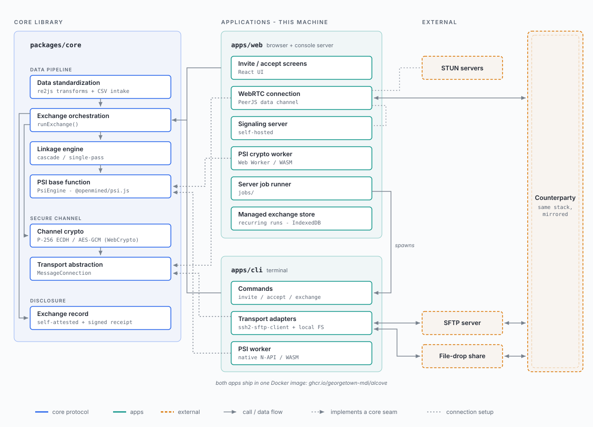

# Alcove documentation

Alcove is a privacy-preserving record linkage (PPRL) tool that enables partner agencies to identify shared members across administrative datasets without revealing anything about the records they do not have in common. It implements a private set intersection (PSI) protocol available both as a browser-based web application and a containerized CLI, and is designed to work within the policy and infrastructure constraints typical of government agencies.

## Role-based reading guide

| I am a... | Start with... | Then read... |
|-----------|--------------|--------------|
| Analyst running one exchange in the browser | [WEB_APP.md](WEB_APP.md) | [MANAGED_EXCHANGE.md](MANAGED_EXCHANGE.md), for running it again on a schedule |
| Partner who received an invitation | [WEB_APP.md](WEB_APP.md#accepting-an-invitation) | [PRIVACY.md](../PRIVACY.md) |
| Program officer evaluating the software | [DESIGN.md](DESIGN.md) | [SECURITY_DESIGN.md](SECURITY_DESIGN.md), [COMPLIANCE.md](COMPLIANCE.md) |
| Security reviewer or auditor | [SHARED_RESPONSIBILITY.md](SHARED_RESPONSIBILITY.md) | [SECURITY_DESIGN.md](SECURITY_DESIGN.md), [PROTOCOL.md](spec/PROTOCOL.md), [CHANNEL_SECURITY.md](spec/CHANNEL_SECURITY.md), [COMPLIANCE.md](COMPLIANCE.md) |
| Compliance officer | [COMPLIANCE.md](COMPLIANCE.md) | [PRIVACY.md](../PRIVACY.md), [SECURITY_DESIGN.md](SECURITY_DESIGN.md) |
| Privacy reviewer | [PRIVACY.md](../PRIVACY.md) | [COMPLIANCE.md](COMPLIANCE.md), [SECURITY_DESIGN.md](SECURITY_DESIGN.md) |
| IT professional operationalizing an exchange | [CLI.md](CLI.md) | [EXCHANGE_REFERENCE.md](EXCHANGE_REFERENCE.md), [DEPLOYMENT.md](DEPLOYMENT.md) |
| Operator running one exchange from a graphical console on their own machine | [CONSOLE.md](CONSOLE.md) | [CLI.md](CLI.md), [EXCHANGE_REFERENCE.md](EXCHANGE_REFERENCE.md) |
| Operator running a recurring exchange from the browser | [MANAGED_EXCHANGE.md](MANAGED_EXCHANGE.md) | [SECURITY_DESIGN.md](SECURITY_DESIGN.md), [MANAGED_EXCHANGE_RECORD.md](spec/MANAGED_EXCHANGE_RECORD.md) |
| Developer contributing to the project | [DESIGN.md](DESIGN.md) | [PROTOCOL.md](spec/PROTOCOL.md), [COMMUNICATION.md](COMMUNICATION.md), [FILE_SYNC.md](spec/FILE_SYNC.md), [CONTRIBUTING.md](../CONTRIBUTING.md), [TESTING.md](TESTING.md) |
| Maintainer upgrading a pinned dependency | [CONTRIBUTING.md](../CONTRIBUTING.md#dependency-policy) | [DEPENDENCY_PINS.md](spec/DEPENDENCY_PINS.md), [PREBUILD_REVENDOR.md](PREBUILD_REVENDOR.md) |
| Partner agency whose IT staff run the command line app | [CLI.md](CLI.md#your-first-recurring-exchange) | [EXCHANGE_REFERENCE.md](EXCHANGE_REFERENCE.md) |

## Glossary

The screens, messages, and guides use the words below. Configuration keys, command-line flags, environment variable names, and code keep their own names.

| Word | What it names | Where it is set |
|------|---------------|-----------------|
| Alcove | This software, on either side of an exchange | - |
| partner | The other party to an exchange; "you" and "your" are this party | - |
| invitation | What one party sends the other to set up an exchange: the proposed terms, a short-lived secret, and optionally where to meet. It is sent as a link to the web app or as text to paste | `alcove invite`, `alcove accept`, `alcove exchange --invitation` ([CLI.md](CLI.md#invitations)) |
| quick exchange | An exchange with no invitation and no shared secret, run against a server or shared folder both parties already agreed on | `alcove URL INPUT_FILE`, or the console's quick exchange; `--save` keeps its settings ([CLI.md](CLI.md#quick-exchange)) |
| shared folder | The folder both parties read and write when an exchange runs through files: a network share or a synced folder | `connection.channel: filedrop` with [`connection.path`](EXCHANGE_REFERENCE.md#connectionpath), or `inbound_path` and `outbound_path`; on the console, `JOB_RENDEZVOUS_DIR` |
| coordination server | The server two parties connect through to start a WebRTC exchange; it passes setup messages and never sees exchange data | `connection.channel: webrtc` with `connection.server`; for the web app, `VITE_SIGNALING_SERVER_URL` ([DEPLOYMENT.md](DEPLOYMENT.md#coordination-server)). Code and the package name call it the broker |
| working folder | The one folder the console mounts, holding an exchange's configuration, key file, input, and results. Console screens call it "your folder" | `JOB_DATA_ROOT` ([CONSOLE.md](CONSOLE.md)) |
| exchange record | The file each party keeps of what its exchange disclosed, `alcove-record-<time>.json`, with its verification keys | Written by default; `--no-record` turns it off |
| signed receipt | The file both parties sign at the end of an exchange, `alcove-receipt-<time>.json`: the evidence of the terms both agreed on and the data that flowed | [`signing.mode: certificate`](EXCHANGE_REFERENCE.md#signingmode) |

## Document inventory

The documentation is organized in three tiers: this **overview** tier (`docs/`) of conceptual and operational documents; a **technical specification** tier ([`docs/spec/`](spec/README.md)) of wire formats, byte encodings, normative constants, and implementation-level design for implementors and auditors; and a **design notes** tier ([`docs/notes/`](notes/README.md)) of citeable, non-normative design records: the model behind a mechanism, the options weighed, and the decisions taken. The spec and notes tiers each have their own index.

### Guides ([`docs/guides/`](guides/index.md))

Step-by-step instructions for one reader's path through an exchange: agreeing the terms with a partner, then inviting, accepting, and scheduling in the web app, the console, or the command line. Each guide links into the overview documents below for depth.

### Overview (`docs/`)

- [WEB_APP.md](WEB_APP.md) - running one exchange in the browser: creating or accepting an invitation, the results, and the exchange record
- [MANAGED_EXCHANGE.md](MANAGED_EXCHANGE.md) - running that exchange again on a schedule from the browser: saving, installing, the schedule, moving it, failed runs, the accounting of disclosures, and backups
- [CLI.md](CLI.md) - IT staff running exchanges from the command line: a task index, a first recurring exchange, every command, scheduling, recovery, and exit codes
- [EXCHANGE_REFERENCE.md](EXCHANGE_REFERENCE.md) - every field of the exchange configuration file, `alcove.yaml`
- [CONSOLE.md](CONSOLE.md) - running one exchange from the graphical console on your own machine: the container, its mounts and settings, and the hand-off to the command line
- [DEPLOYMENT.md](DEPLOYMENT.md) - IT staff hosting Alcove: the supporting services, network requirements, how large an exchange can be, and the command line app under Docker
- [FIPS_SFTP_PROFILE.md](FIPS_SFTP_PROFILE.md) - the SFTP settings for an agency required to use FIPS-approved cryptography, what they exclude, and the host-key gap
- [DESIGN.md](DESIGN.md) - the whole picture: what Alcove does, its architecture, the configuration in summary, and the user journey
- [SECURITY_DESIGN.md](SECURITY_DESIGN.md) - the PSI privacy guarantee, the threat model, authentication, channel security, and key rotation
- [SHARED_RESPONSIBILITY.md](SHARED_RESPONSIBILITY.md) - what the project is responsible for and what the deploying agency is, per deployment
- [COMPLIANCE.md](COMPLIANCE.md) - regulatory framings, data classification, and what a reviewer checks
- [SERVICE_FACT_SHEET.md](SERVICE_FACT_SHEET.md) - one page of facts, for counsel, about each service the project runs for the hosted web application
- [COMMUNICATION.md](COMMUNICATION.md) - how an exchange proceeds: the channels, synchronization, the web invitation and consent screens, message delivery, error handling, and the supporting services
- [INCIDENT_RESPONSE.md](INCIDENT_RESPONSE.md) - how the maintainer handles a reported vulnerability, behind [SECURITY.md](../SECURITY.md), and the tabletop exercise record
- [RELEASES.md](RELEASES.md) - the versioning policy, the release checklist, and verifying the published artifacts
- [PREBUILD_REVENDOR.md](PREBUILD_REVENDOR.md) - replacing the vendored native PSI build: the integrity controls, the procedure, and chain of custody
- [TESTING.md](TESTING.md) - where a test goes, the integration backends and profiles, the console check, the browser suite, and coverage
- [ROADMAP.md](ROADMAP.md) - what is planned next

### Technical specifications ([`docs/spec/`](spec/README.md))

- [PROTOCOL.md](spec/PROTOCOL.md) - the PSI and PSI-C algorithms, linkage, the steps after linkage, and the P-256 key exchange
- [CHANNEL_SECURITY.md](spec/CHANNEL_SECURITY.md) - the application-layer encryption and the authenticated abort marker
- [TRANSPORT_BOUNDS.md](spec/TRANSPORT_BOUNDS.md) - memory bounds on what a hostile server or partner writes for a party to read
- [TRANSPORT_LIVENESS.md](spec/TRANSPORT_LIVENESS.md) - the deadlines that fail a stalled transport operation, and the SFTP heartbeat
- [SFTP_CONNECTION.md](spec/SFTP_CONNECTION.md) - the server-provisioning call, SFTP crash safety, and host-key verification
- [SFTP_SESSION_RECOVERY.md](spec/SFTP_SESSION_RECOVERY.md) - how a dropped SFTP session is re-dialed, and its bounds
- [PARSED_INPUT_BOUNDS.md](spec/PARSED_INPUT_BOUNDS.md) - bounds on a partner's input, the CSV-read ceiling and header sanitation, and the linkage-terms name rule
- [TRANSFORM_REGEX_DIALECT.md](spec/TRANSFORM_REGEX_DIALECT.md) - the linear-time regular expression dialect of partner-authored transforms, and its bounds
- [TRANSFORM_PARAMETER_BOUNDS.md](spec/TRANSFORM_PARAMETER_BOUNDS.md) - the type of each transform parameter, and the bounds on per-row work
- [DISPLAY_ESCAPE.md](spec/DISPLAY_ESCAPE.md) - how partner- and server-chosen text is escaped where it is shown
- [DISPLAY_REDACTION.md](spec/DISPLAY_REDACTION.md) - how private-key material is removed from what is shown, and the length budgets
- [SIGNALING_SERVER_BOUNDS.md](spec/SIGNALING_SERVER_BOUNDS.md) - the bounds the coordination server holds against an unauthenticated client
- [FILE_SYNC.md](spec/FILE_SYNC.md) - the `sftp` and `filedrop` channels: the shared folder as a state machine, file names, and preconditions
- [WEBRTC_TRANSPORT.md](spec/WEBRTC_TRANSPORT.md) - the `webrtc` channel: rendezvous roles, signaling messages, data-channel framing and close, the ICE list rule, and limits
- [EXCHANGE_RECORD.md](spec/EXCHANGE_RECORD.md) - the exchange record: its files, the commitment scheme, governance metadata, and privacy properties
- [EXCHANGE_FILE.md](spec/EXCHANGE_FILE.md) - the exchange file the web app downloads, its versioning, the invitation channel-binding rule, and key file provisioning
- [INVITATION_TOKEN.md](spec/INVITATION_TOKEN.md) - the invitation token's encoding, fields, size bounds, and the checks on minting and accepting it
- [DEFAULT_STANDARDIZATION.md](spec/DEFAULT_STANDARDIZATION.md) - the default cleaning per data type, and the column-name table behind the inferred defaults
- [CANONICAL_ENCODING.md](spec/CANONICAL_ENCODING.md) - the RFC 8785 encoding that receipts, record commitments, and the agreed-terms hash are computed over
- [CREDENTIAL_STORAGE.md](spec/CREDENTIAL_STORAGE.md) - how the key file, signing identity, exchange record, and result CSV are written owner-only and durably
- [MANAGED_EXCHANGE_RECORD.md](spec/MANAGED_EXCHANGE_RECORD.md) - the record a recurring web exchange stores, the save-before-success order, the one-owner rule, and the export file
- [CLI_EVENTS.md](spec/CLI_EVENTS.md) - the opt-in `--event-stream` output: framing, event types, error categories, and sanitization
- [CLI_DOCTOR.md](spec/CLI_DOCTOR.md) - the `alcove doctor --json` document: fields, schema version, status values, checks, and exit codes
- [SERVER_JOB_API.md](spec/SERVER_JOB_API.md) - the console's job API: request schema, SFTP connection, lifecycle, working-folder layout, event relay, and startup rules
- [DEPENDENCY_PINS.md](spec/DEPENDENCY_PINS.md) - the exact-pinned SFTP and WebRTC stack, the upgrade checklists, and the install-script policy
- [CONTAINER_IMAGES.md](spec/CONTAINER_IMAGES.md) - the standard and FIPS images: dependency pinning, the FIPS provider's CMVP certificate coverage, and the writable and setuid inventories

### Design notes ([`docs/notes/`](notes/README.md))

Tracked, citeable design records: the model behind a mechanism, the options weighed, and the decisions taken. Nothing here binds an implementation; a note points at the spec for the normative rows. Its [index](notes/README.md) lists each note with its status and holds the maturity ladder from `scratch/` up to the formal tiers.

The web application's interface has its own record outside this tree: [`design/web-redesign/`](../design/web-redesign/README.md) holds the chosen redesign as a non-functional HTML mockup, with the framing, the alternatives weighed, and the civic-design sourcing behind it. `apps/web/src/exchange/`, `apps/web/src/recurring/`, and `apps/web/src/console/` implement that direction.

## System architecture

One library, `packages/core`, holds the protocol; the apps supply what core leaves abstract - the transport channel (`MessageConnection`) and the PSI compute backend (`PsiEngine`). Both apps ship in one Docker image. [DESIGN.md](DESIGN.md) narrates this architecture; the [spec tier](spec/README.md) holds the wire-level detail.

To revise this diagram or add another figure to the docs, follow the `doc-figure` skill ([`.claude/skills/doc-figure/SKILL.md`](../.claude/skills/doc-figure/SKILL.md)).
